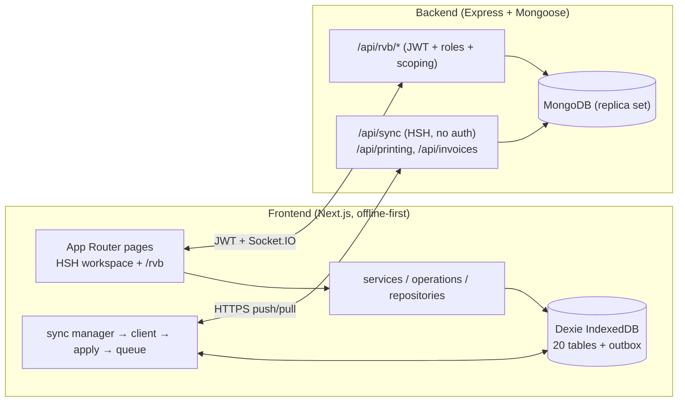

# HSH — Poultry Business Suite

HSH (Hebrih Slaughter House) is an offline-first business-management system for a poultry
slaughterhouse, plus an R.V.B portal that gives workers, suppliers, and customers scoped
self-service access to their own data.

- **HSH workspace** — inventory, sales, purchases, payments, transfers, expenses, workers,
  vehicles, tasks, invoices, reports, notifications, and a document/spreadsheet office.
  Single-tenant desktop-style web app. Works fully offline against local IndexedDB and
  converges with the server through a revision-based sync protocol.
- **R.V.B portal** (`/rvb`) — authenticated multi-user web surface (also serves the
  `R.V.B-mobile/` client through the same `/api/rvb/*` API). Role-based access
  (`manager`, `supervisor`, `worker`, `supplier`, `customer`) with server-side ownership
  checks on every request.

## Technology stack

| Layer | Implementation |
|---|---|
| Frontend | Next.js 16 (App Router) + React 19, `H.S.H-V2.0.0/frontend` |
| Local data | Dexie (IndexedDB) database `HebrihSlaughterHouse`, 20 entity tables + sync outbox |
| Sync transport | Plain HTTPS (`POST /api/sync`, `GET /api/sync/changes|snapshot|bootstrap|status`) |
| Backend | Express 5 + Mongoose 9 + MongoDB, `H.S.H-V2.0.0/backend` |
| Realtime | Socket.IO (`/api/rvb/chats/socket`) for chat, typing, notifications |
| Chat media | Cloudinary, local-dev, or mock provider |
| Printing | `puppeteer-core` + `pdf-to-printer` (Windows printer support) |
| Localization | Trilingual inline dictionaries (`en`, `fr`, `ar`), Arabic RTL, Latin digits forced |
| Tests | `tsx` harnesses (no jest/vitest) + Playwright E2E; one-command `release-gate.mjs` |

## Repository structure

```text
.
├── README.md / AGENTS.md          # entry point / agent + contributor instructions
├── docs/                          # permanent documentation (this set only)
├── release-gate.mjs               # one-command release verification gate
├── H.S.H-V2.0.0/
│   ├── frontend/                  # Next.js app (HSH workspace + /rvb portal)
│   ├── backend/                   # Express API (HSH sync + /api/rvb/*)
│   └── RVB-MOBILE-CONTRACT.md     # frozen web/mobile API + deployment-mode contract
└── R.V.B-mobile/                  # mobile client (separate ownership — do not modify)
```

`H.S.H-V2.0.0/frontend/README.md` and `H.S.H-V2.0.0/backend/README.md` are the
package-level install notes; the guides under `docs/` are authoritative when they differ.

## High-level architecture



- The frontend reads and writes Dexie locally; every mutation also queues an outbox op.
  A background sync cycle pushes the outbox and pulls server changes (`docs/SYNCHRONIZATION.md`).
- The backend applies HSH operations transactionally, allocates a monotonic global
  revision per mutation, and records a `SyncChange` row per mutation for incremental pull.
- R.V.B requests (worker/supplier/customer orders and requests) are reviewed by
  management and materialize as real HSH `Sale`/`Purchase` transactions on acceptance.

See `docs/ARCHITECTURE.md` for the full picture.

## Prerequisites

- Node.js 20 or later.
- MongoDB 7+ as a **replica set** (transactions are required for sync push and request
  reviews; a standalone server breaks those paths).
- Backend: copy `H.S.H-V2.0.0/backend/.env.example` → `.env` and set `MONGODB_URI`.
  Production additionally requires `RVB_JWT_ACCESS_SECRET`, `RVB_JWT_REFRESH_SECRET`,
  explicit `SERVER_MODE`, and real `CORS_ORIGIN` (see `docs/DEPLOYMENT.md`).

## Installation and development startup

```powershell
# Backend (port 5000)
cd H.S.H-V2.0.0/backend
npm ci
npm run dev        # tsx src/server.ts

# Frontend (port 3000) — separate terminal
cd H.S.H-V2.0.0/frontend
npm ci
npm run dev        # next dev
```

The frontend expects `NEXT_PUBLIC_API_URL=http://localhost:5000` (see
`H.S.H-V2.0.0/frontend/.env.example` → copy to `.env.local`). Full workflow, environment
reference, and troubleshooting: `docs/DEVELOPMENT.md`.

## Testing and production build

```powershell
node release-gate.mjs                 # full gate: typechecks, suites, build
node release-gate.mjs --skip-build    # suites only
```

- Backend gate: `npm test` → `test-pagination.ts`, `test-chat-unread-reuse.ts`,
  `test-hsh-sync-integrity.ts`; plus requests (39), chat (52), failure-injection,
  authz-matrix, and backup suites.
- Frontend gate: `npm test` (i18n parity + notification/date/number suites),
  `test:hsh-client`, snapshot-migration (18), then `npm run build`.
- Browser E2E (Playwright, HSH 11 + RVB 4 suites) is intentionally manual.
- Details: `docs/TESTING.md`. Deployment: `docs/DEPLOYMENT.md`.

## Documentation map

| Document | Contents |
|---|---|
| `docs/ARCHITECTURE.md` | System overview, shells, modules, request lifecycle, key decisions |
| `docs/DATABASE.md` | Collections, relationships, indexes, integrity rules |
| `docs/API.md` | Endpoint groups, auth, pagination, errors, Socket.IO events |
| `docs/SYNCHRONIZATION.md` | Offline-first design, outbox, snapshot protocol, revisions, recovery |
| `docs/SECURITY.md` | Auth model, roles, boundaries, secrets, limitations |
| `docs/DEVELOPMENT.md` | Setup, env reference, workflow, troubleshooting |
| `docs/TESTING.md` | Test layers, commands, replica-set rules, budgets, release gate |
| `docs/DEPLOYMENT.md` | Build, production config, health, backup, rollback, shutdown |
| `H.S.H-V2.0.0/RVB-MOBILE-CONTRACT.md` | Frozen web/mobile contract (deployment modes, auth, DTO rules) |
| `AGENTS.md` | Mandatory instructions for agents and contributors |
