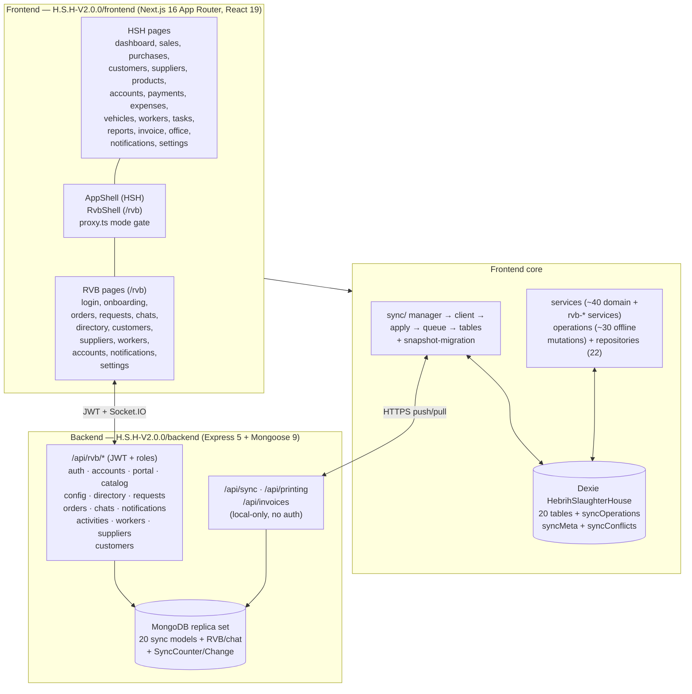

# Architecture

HSH is two applications sharing one repository: an offline-first single-tenant HSH
workspace and an authenticated multi-user R.V.B portal, backed by one Express API
and one MongoDB database.



## Frontend boundaries

`app/**/page.tsx` (all client components) → `src/services/*` (domain logic, Dexie
reads) → `src/services/operations/*` (offline-first mutations: create/edit/reversal/
delete per entity + `database-transaction.ts`) → `src/repositories/*` (Dexie CRUD
wrapper over `base.repository.ts`) → Dexie (`src/lib/database/db.ts`, schema v1–v10,
append-only versions).

- **Shells.** `app/layout.tsx` mounts HSH `AppShell` + `RvbAuthProvider` +
  `SyncInitializer` (starts the sync manager). `app/rvb/layout.tsx` mounts `RvbShell`.
  `proxy.ts` enforces `FRONTEND_MODE`: `full` passes everything through; `rvb-public`
  allows only `/rvb/**` (+ `/_next`, frontend `/api`, public assets) and redirects
  `/` and all HSH routes to `/rvb`.
- **Guards.** `RvbAuthGuard` (authenticated), `RvbRoleGuard` (role), plus a
  web guard order: unauthenticated → `/rvb/login`; `mustChangePassword` →
  `/rvb/auth/change-password`; `onboardingStatus === pending` → `/rvb/onboarding`.
- **State.** No global store. Server state lives in Dexie; RVB session lives in
  `RvbAuthContext` (memory-only access token, `HttpOnly` refresh cookie,
  `credentials: include`, single shared refresh promise, 401 → refresh → retry).
  `useDbSync.ts` subscribes components to sync-manager state.
- **Heavy editors are route-split.** Univer sheets load via `next/dynamic ssr:false`;
  ExcelJS/DOMPurify via `await import()` in handlers. `next.config.ts` sets only
  `experimental.optimizePackageImports: ["lucide-react"]`.
- **Errors.** `app/error.tsx` (retry via `reset()` with reload fallback),
  `app/global-error.tsx` (self-contained), `app/not-found.tsx`, all rendering the
  shared `AppErrorPage` with digest-only logging — raw exceptions are never rendered.

## Backend boundaries

`src/server.ts` (`startServer()`) → `src/routes/*` (thin HTTP: auth, validation,
rate limits) → `src/services/*` (business rules) → `src/models/*` → MongoDB.
Cross-cutting: `middleware/rvb-auth.ts` (JWT + live-session check),
`middleware/rateLimiter.ts` (in-memory buckets), `lib/validate-items.ts`
(server-recomputed `weight × price` totals), `lib/escape-regex.ts`,
`lib/password.ts` (bcrypt cost 10), `lib/rvb-auth.ts` (token issue/verify).
There is no global error middleware — every handler try/catches into
`{ success:false, code, message }`.

Request lifecycle for an RVB request (e.g. `POST /api/rvb/customer-orders`):

```mermaid
sequenceDiagram
    participant C as Client
    participant S as server.ts (CORS, cookies, body 1 MB,<br/>login/refresh IP limits, X-Request-Id)
    participant A as requireRvbAuth<br/>(Bearer → cookie → X-RVB-Token;<br/>account + session live-check)
    participant R as requireRvbRole +<br/>account-keyed rate limit
    participant H as Route handler<br/>(validate-items,<br/>server-recomputed totals)
    participant M as MongoDB transaction<br/>(+ SyncChange row)
    C->>S->>A->>R->>H->>M
    M-->>C: 200 {success:true, ...} + paging meta when requested
```

- `SERVER_MODE=full` mounts `/api/sync`, `/api/printing`, `/api/invoices` plus all
  `/api/rvb/*`. `SERVER_MODE=rvb-public` replaces the three HSH routers with `404`
  and mounts only `/api/rvb/*` + `/api/health`. Production boot with `full` and
  without `ALLOW_FULL_SERVER_IN_PRODUCTION=true` refuses to start.
- Startup runs best-effort index hooks (`ensureConversationIndexes`,
  `ensureNotificationIndexes`, `ensurePortalListIndexes`) but **fatal** guards
  (`ensureCustomerOrderIdempotencyIndex`; production without DB refuses to listen).
- Shutdown is graceful: `SIGTERM`/`SIGINT` → stop chat reminder + upload-cleanup
  processors → drain HTTP → disconnect Mongoose → exit, with a 10 s forced fallback.

## Major modules

| Area | Frontend | Backend |
|---|---|---|
| Sales / purchases / payments / transfers | pages + `sale/purchase/payment/transfer.service` + operations | sync handlers with stock/balance guards in transactions |
| Invoice | `/invoice` pages, `invoice.service`, `FormalInvoiceDocument` | `routes/invoice.ts` (`/issue`, `/cancel`, `/incoming`), atomic issue transaction |
| Office | `/office` file manager, TipTap docs, Univer sheets, templates/KPIs | `officeFile` sync entity |
| Reports / printing | `/reports`, print-preview pages | `routes/printing.ts` (`/printers`, `/print`, `/invoice`, `/pdf`, `/invoice/pdf`) |
| Notifications | `/notifications`, `HshNotificationBell` / `RvbNotificationBell` | HSH `notification` sync entity (`channel=hsh` only); RVB per-recipient state |
| Chat | `/rvb/chats` | `routes/chats.ts` + `chat.service.ts` + Socket.IO + reminders + upload cleanup |
| RVB requests/orders | `/rvb/requests`, `/rvb/orders` | worker/supplier/customer request routers + review transactions → Sale/Purchase |

## Key decisions (load-bearing — do not relitigate casually)

- **Offline-first, server-convergent.** The client is usable with no backend; the
  server is the revision authority. Conflicts resolve server-side with terminal vs.
  retryable outcomes (see `docs/SYNCHRONIZATION.md`).
- **Server owns money.** Client totals and customer prices are never trusted;
  `total = round(weightKg × price)`, customer price forced to `Product.price`.
- **Single-tenant HSH, multi-user RVB.** HSH has no login by design; RVB has JWT +
  rotating refresh + per-resource ownership. The deployment-mode pair
  (`SERVER_MODE` + `FRONTEND_MODE`) is the public-exposure control.
- **Additive evolution.** New query params, response fields, and endpoints
  (`GET /api/sync/snapshot`); legacy shapes byte-identical when new params are
  absent. Dexie versions append-only.
- **RVB isolation from HSH Dexie.** No `/rvb` import path may reach
  `src/lib/database/db.ts`; RVB language preference is `preferences.ui.language`,
  company currency comes from `GET /api/rvb/config`.
- **Desktop client reuses the same architecture.** `HSH-Desktop/` is an Electron
  shell around the packaged Next.js production build (`output: "standalone"`,
  served on loopback) with a runtime backend-URL override
  (`resolveApiBase()` in `src/lib/api-base.ts`). Same API contracts, same
  Dexie/outbox/sync protocol, same backend — no forked logic (see
  `HSH-Desktop/README.md`).
