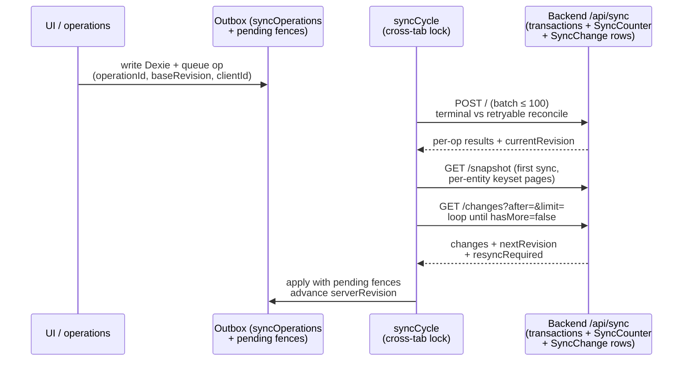

# Synchronization

HSH is offline-first: the frontend works entirely against local Dexie and converges
with the server through a revision-based push/pull protocol. The server is the
revision authority; the client holds its cursor (`serverRevision`).

## Client (`frontend/src/services/sync/`)

| File | Responsibility |
|---|---|
| `manager.ts` | `syncCycle` = push then pull; cross-tab mutual exclusion via `navigator.locks:hebrih-hsh-sync` with `syncMeta.syncLease` fallback (30 s TTL, 10 s heartbeat); 20 s interval + online/focus/visibility triggers; 500 ms debounced `triggerSync` on local mutation; `SyncInitializer` starts the manager |
| `client.ts` | Transport: push `POST /api/sync` (batch 100), pull `GET /changes?after&limit`, `bootstrap`, per-entity `snapshot?entity&cursor&limit`, `status`; trims trailing `/` from `NEXT_PUBLIC_API_URL` |
| `queue.ts` | Outbox: CREATE+UPDATE coalescing, terminal/retrying/`in_flight` immutability, `dependsOn`/`parentOperationId` ordering, `clientId`/`serverRevision` bookkeeping, pending fences |
| `apply.ts` | Remote apply: `applyRemoteChange(s)`, `applySnapshot`, `applySnapshotEntity` (pending-fence upserts + per-entity missing-local deletes), `applyBootstrapChanges` |
| `tables.ts` | 20-entity registry (`SYNC_ENTITIES`) mapping entity → Dexie table |
| `snapshot-migration.ts` / `migrate.ts` | Chunked resumable first-sync (200/page, progress in `syncMeta.snapshotMigration`); legacy backfill |

- **First sync.** Chunked migration walks `SYNC_ENTITIES` in order, paging
  `GET /snapshot?entity=&cursor=&limit=` (limit ≤ 500) until `hasMore = false`
  per entity, then pulls `/changes` after the returned `currentRevision` to cover
  concurrent writes. Transport failure falls back to legacy `GET /bootstrap`
  (convergent, no loss). Progress persists, so an interrupted migration resumes.
- **Steady state.** Push drains the outbox (dependency-aware, terminal vs.
  retryable reconciliation with shared bootstrap reconcile), then pull loops
  `/changes` until drained, advancing the cursor. Rev-0 with an empty probe
  converges forward.
- **Remote writes never re-queue.** All remote applies run inside `runAsRemote()`
  (`src/lib/database/sync-hooks.ts`); without it every pull would re-enqueue.
- **Conflicts.** Stale `baseRevision` ops are rejected by the server; outcomes land
  in `syncConflicts`. Tombstone `delete` changes flow like any other change.

## Server (`backend/src/sync/` + `routes/sync.ts`)

- `POST /api/sync` validates op shape (`entity/entityId/operation/createdAt/
  operationId`, registry membership) and runs `processSyncOperations`: per-entity
  handlers for sale/purchase/payment/transfer create/update/delete plus generic
  upsert paths, each in a Mongo transaction with stock/balance guards and item
  validation (≤ 500 lines, integer `quantity > 0`, `total = round(weight × price)`
  ± 0.005). Every applied mutation allocates one monotonic revision from the
  atomic `SyncCounter` (`getNextRevision`) and writes one `SyncChange` row; each
  `operationId` gets an idempotent `ProcessedSyncOperation` record (terminal vs.
  retryable for replays).
- `GET /changes?after=&limit=` returns `{ changes, nextRevision, hasMore,
  currentRevision, resyncRequired }`. `resyncRequired: true` fires when `after`
  predates the oldest retained `SyncChange` row; new clients re-migrate from rev 0
  on sight (old clients ignore the unknown flag).
- `GET /bootstrap` returns all 20 entities in sequential full scans
  (notifications pinned to `channel = "hsh"`) plus `currentRevision`. Unbounded by
  design — new code must prefer `/snapshot`.
- `GET /snapshot?entity=&cursor=&limit=` pages one entity by keyset over unique
  `id` (`$gt` cursor, `sort({ id: 1 })`, `limit + 1` probe), stripping `_id`/`__v`.
  Unknown entity → 400. Notifications pinned to `channel = "hsh"`.
- `GET /status` returns `{ currentRevision }`.
- RVB-side writes (account, request, config mutations) record revisions through
  `rvb-sync-helper.ts` (`allocateRevision` + `recordSyncChange`) so HSH pull sees
  them.

## Retention

`SyncChange` rows grow without bound. **No deletion/compaction job exists.**
Deleting history below an unknown client cursor would cause silent skips, so any
future retention job is gated on: (a) all active devices running the
migration-capable build, (b) one full offline-grace window (proposed 90 days),
(c) its own test. Tombstones must be retained at least as long as regular changes.
The `resyncRequired` guard is already implemented and covered by the snapshot
harness; the deletion job itself is future work, not implemented behavior.

## Compatibility requirements

- Protocol changes are additive only: new query params, response fields, or
  endpoints. Never change push/pull semantics, revision monotonicity,
  `clientId`/`serverRevision`/`operationId` handling, or fence behavior.
- Dexie schema versions are append-only; a client that opened a newer version
  keeps extra tables harmlessly, but do not downgrade Dexie code below the data
  version in use without testing.
- HSH sync has no authentication. Exposure control is the deployment binding:
  trusted networks run `SERVER_MODE=full`; public/mobile deployments run
  `SERVER_MODE=rvb-public` (HSH routes 404) — see `docs/SECURITY.md` and
  `docs/DEPLOYMENT.md`.
